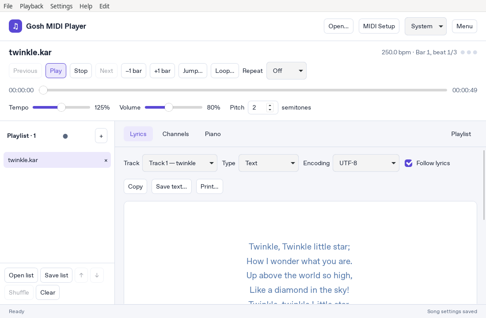

# Gosh MIDI Player

A MIDI and karaoke player written in Rust with Dioxus Desktop. It reads MID,
MIDI, KAR, RIFF RMID and Cakewalk WRK files, and sends MIDI to FluidSynth or
native external MIDI ports. The executable retains the name `dmidiplayer`.

**2.0.0-alpha.1 is a prerelease.** Linux desktop, native dialogs, real audio,
clipboard, printing and Linux packages have been exercised. Windows desktop
code and both macOS core targets compile. The installed Flatpak passes its core
and WebView checks; native Windows/macOS acceptance and Flatpak document portals
remain open. See [validation](docs/VALIDATION.md)
for evidence and remaining release gates.

The [user guide](docs/USER_GUIDE.md) describes the current controls and workflows.



## Features

- Play, pause, resume, stop, seek, bar steps, jump, loops and song/playlist repeat.
- Tempo, volume and transpose; percussion remains untransposed.
- Playlists with add, remove, reorder, shuffle, recent files and unsaved-change protection.
- Reachable Lyrics, Channels and Piano tabs; channel mute, solo, program lock,
  instrument, name, level and meters; piano audition and note highlighting.
- Lyrics track/type/charset filters, karaoke line formatting, follow position,
  native clipboard, text export and system printing.
- MIDI setup, port refresh, test note, GM/GS/MT-32 maps, resets, companion SysEx,
  SF2/SF3 SoundFonts and an explicit silent Dummy output.
- Apply/Cancel preferences, compatible settings and per-song mixes, live
  System/Light/Dark appearance, saved window geometry and local file activation.

The original GPL application and its authors remain credited. The baseline
behavior and intentional fixes are documented in [MIGRATION_AUDIT.md](MIGRATION_AUDIT.md).
The application uses WebView2 on Windows, WKWebView on macOS and WebKitGTK on
Linux. GTK hosts the Linux WebView and native integrations. No Node runtime is used.

## Build and run

Install stable Rust with rustfmt and clippy; `rust-toolchain.toml` pins the tested
compiler. Use the checked-in Cargo.lock.

Linux (Debian/Ubuntu):

```sh
sudo apt-get update
sudo apt-get install libwebkit2gtk-4.1-dev libgtk-3-dev libxdo-dev \
  libayatana-appindicator3-dev libasound2-dev libfluidsynth3 \
  xdg-desktop-portal xdg-desktop-portal-gtk
```

Use your desktop's portal provider, such as the GTK or KDE provider. macOS needs
Xcode Command Line Tools; `brew install fluidsynth` supplies a development audio
runtime. Windows needs Visual Studio C++ Build Tools with the Windows SDK,
MSVC Rust, and the Microsoft WebView2 Runtime. The release workflow supplies
FluidSynth DLLs through the pinned vcpkg manifest.

```sh
cargo build --locked
cargo run --locked -- examples/twinkle.kar
# GUI without an audio device:
cargo run --locked -- --driver Dummy --connection dummy examples/test.mid
# Decode actual inputs without starting a desktop:
cargo run --locked -- --dry-run examples/test.mid
cargo run --locked -- --dump-info examples/twinkle.kar
```

A missing synthesizer or output device is reported in the UI. Select an external
MIDI port or a valid SoundFont in MIDI Setup. Packaged builds carry a verified
MIT-licensed GM SoundFont. Development builds can point to any accessible SF2/SF3.

## Checks and packages

```sh
sh scripts/verify.sh
cargo build --locked --release
python3 scripts/fetch-resources.py
cargo fetch --locked
python3 scripts/package-native.py
```

The packager produces Linux `.deb`/`.tar.gz`, Windows MSI/portable ZIP, or a
macOS `.app` ZIP on the corresponding OS. Artifacts and SHA256SUMS go to `dist/`.
The Linux archive requires the documented system WebView/audio libraries.
macOS bundles currently use ad-hoc signing; certificate signing/notarization
and Windows application signing require a release identity and remain release gates.

For live WebView acceptance:

```sh
cargo build --locked --features ui-test
# Linux in a private test desktop:
xvfb-run -a dbus-run-session -- python3 scripts/desktop-qa.py target/debug/dmidiplayer
# macOS/Windows in their native desktop sessions:
python3 scripts/desktop-qa.py target/debug/dmidiplayer
```

The opt-in harness operates real DOM controls inside the native application.
It does not replace native dialog, external MIDI, or installed-package checks.
Normal builds exclude the harness.

See [platform build instructions](BUILDING.md), [support matrix](PLATFORM_SUPPORT.md),
[contributing](CONTRIBUTING.md), [changes](CHANGELOG.md),
[development](docs/DEVELOPMENT.md), [platforms and packaging](docs/PLATFORMS.md),
[release procedure](docs/RELEASE.md), [architecture](ARCHITECTURE.md), and
[third-party notices](THIRD_PARTY_NOTICES.md). Older translated manuals and
`docs/migration/` describe historical implementations, not current build instructions.
